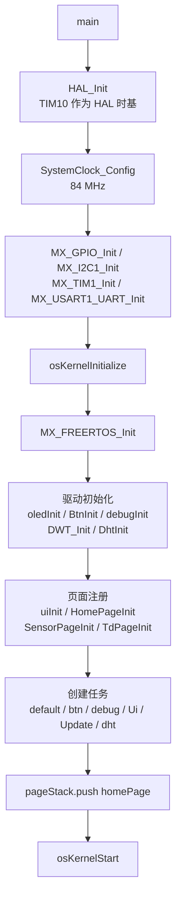
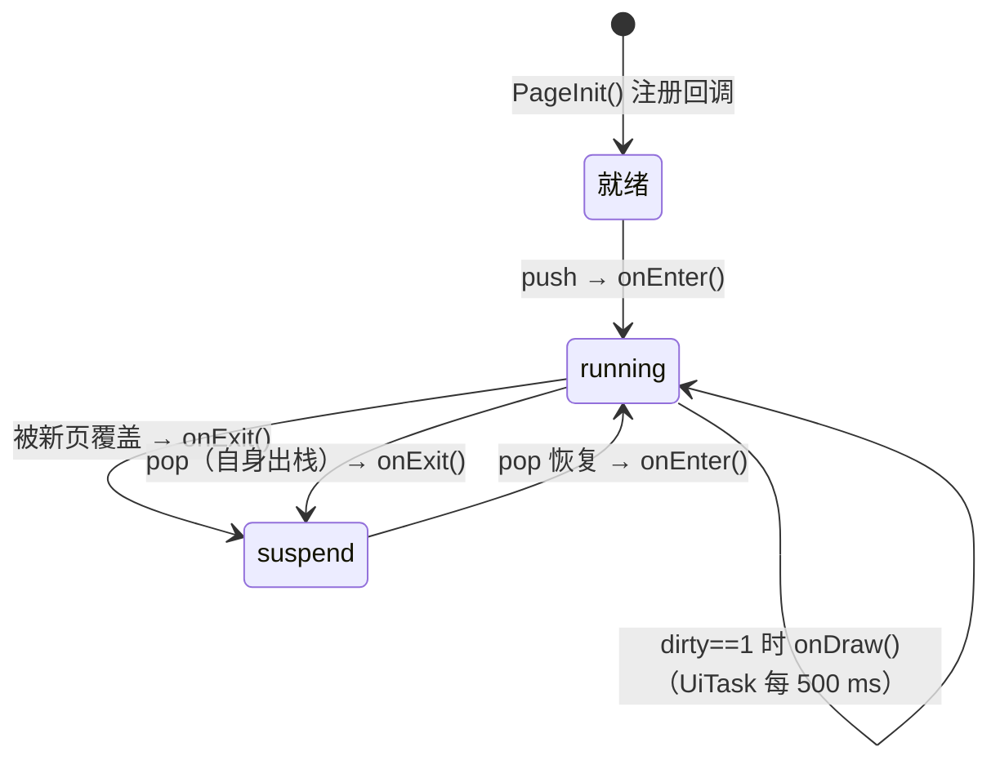
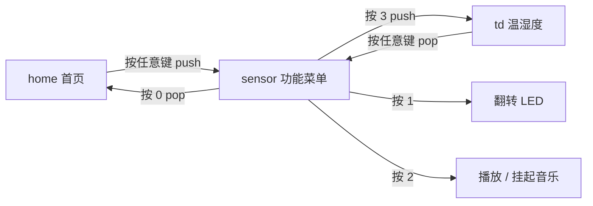

# pageStack

> 基于 **STM32F401RCT6 + FreeRTOS** 的轻量级页面栈（Page Stack）UI 示例。

本项目用一套自绘的「页面栈」管理屏幕界面：每个页面实现 `onEnter / onUpdate / onDraw / onExit`
四个生命周期回调，页面之间通过 `push` / `pop` 切换；按键与 DHT11 传感器数据通过 FreeRTOS
队列（队列集）异步送到当前页面。整体不依赖 LVGL 等 GUI 框架，适合学习任务划分、页面栈、
OLED 驱动和裸机外设驱动在 RTOS 下的组织方式。

---

## 目录

- [功能特性](#功能特性)
- [硬件平台](#硬件平台)
- [目录结构](#目录结构)
- [软件架构](#软件架构)
  - [启动流程](#启动流程)
  - [任务划分](#任务划分)
  - [页面栈机制](#页面栈机制)
  - [输入与事件分发](#输入与事件分发)
- [页面与交互说明](#页面与交互说明)
- [模块说明](#模块说明)
- [关键常量](#关键常量)
- [构建与烧录](#构建与烧录)
- [扩展指南](#扩展指南)
- [已知限制与注意事项](#已知限制与注意事项)
- [许可证](#许可证)

---

## 功能特性

| 功能 | 说明 |
| --- | --- |
| 页面栈 UI | 栈式页面管理，深度 `PAGE_STACK_MAX_DEPTH = 10`，支持进入/返回 |
| 局部刷新 | 页面通过 `dirty` 标志通知 UI 任务重绘，避免无意义刷屏 |
| 4×4 矩阵键盘 | 硬件扫描 + 20 ms 软件消抖 + 松手检测，按键入队 |
| OLED 显示 | SSD1306 128×64，I2C 接口，支持 8×16 ASCII 与 16×16 汉字 |
| DHT11 温湿度 | 单总线位操作读取，校验和验证，每 3 s 采样一次 |
| 蜂鸣器音乐 | TIM1 PWM 输出方波，内置音调表与两首旋律 |
| LED 控制 | PC13 板载 LED 翻转 |
| 串口调试 | USART1 115200，日志经队列异步发送（中断发送） |
| FreeRTOS | CMSIS-RTOS2 API，队列集统一监听按键与传感器事件 |

---

## 硬件平台

- **MCU**：STM32F401RCT6（Cortex-M4F，256 KB Flash / 64 KB SRAM，LQFP64）
- **开发环境**：STM32CubeMX + Keil MDK-ARM
- **系统时钟**：HSI 16 MHz → PLL（M=8, N=84, P=2）→ **84 MHz**，APB1 = 42 MHz，APB2 = 84 MHz
- **HAL 时基**：TIM10（FreeRTOS 独占 SysTick）

### 引脚分配

| 功能 | 引脚 | 模式 / 说明 |
| --- | --- | --- |
| 板载 LED | PC13 | 推挽输出，低电平点亮（`LED_Pin`） |
| 键盘行线 b4–b7 | PA3–PA0 | 推挽输出，扫描时逐行拉低 |
| 键盘列线 b0–b3 | PA7–PA4 | 上拉输入，读取按下状态 |
| OLED SCL | PB6 | I2C1_SCL，100 kHz |
| OLED SDA | PB7 | I2C1_SDA，100 kHz |
| OLED 从机地址 | — | `0x3C`（7 位地址） |
| 蜂鸣器 | PA8 | TIM1_CH1 PWM 输出 |
| DHT11 数据 | PB0 | 单总线，读取时切换输入/输出 |
| 调试串口 | PA9 / PA10 | USART1 TX / RX，115200 8N1 |
| SWD 下载调试 | PA13 / PA14 | SWDIO / SWCLK |

> 键盘矩阵的物理接线与 `BtnInit()` 中的 `map[10][10]` 对应：
>
> ```
> b7/b6/b5/b4（行，输出）
>  1  2  3  A
>  4  5  6  B
>  7  8  9  C
>  *  0  *  D     ← 第 4 行第三列（map[4][1]）当前映射为 '*'，若硬件为 '#' 可在 BtnInit() 中修改
> b3/b2/b1/b0（列，输入）
> ```

---

## 目录结构

```
pageStack/
├── Core/                          # CubeMX 生成的启动与 HAL 工程代码
│   ├── Inc/
│   │   ├── main.h                 # 引脚宏定义
│   │   ├── FreeRTOSConfig.h       # FreeRTOS 配置（1000 Hz tick、30 KB heap_4）
│   │   └── ...
│   └── Src/
│       ├── main.c                 # HAL/时钟/外设初始化 → 启动调度器
│       ├── freertos.c             # 外设初始化、任务创建、应用入口
│       ├── gpio.c / i2c.c / tim.c / usart.c
│       ├── stm32f4xx_it.c         # 中断向量
│       └── stm32f4xx_hal_timebase_tim.c  # 用 TIM10 作为 HAL 时基
├── code/                          # 应用层代码（本项目的核心）
│   ├── page.c / page.h            # 页面栈、UiTask、UpdateTask
│   ├── home.c / home.h            # 首页
│   ├── sensor.c / sensor.h        # 功能菜单页
│   ├── td.c / td.h                # 温湿度页
│   ├── oled.c / oled.h            # SSD1306 OLED 驱动
│   ├── font.c / font.h            # 8×16 ASCII 与 16×16 汉字字库
│   ├── button4_4.c / button4_4.h  # 4×4 键盘扫描
│   ├── dht11.c / dht11.h          # DHT11 驱动与采样任务
│   ├── dwt.c / dwt.h              # DWT 周期计数器微秒延时
│   ├── Music.c / Music.h          # 蜂鸣器音乐播放
│   └── debug.c / debug.h          # 串口调试日志
├── Drivers/                       # CMSIS 与 STM32F4 HAL 驱动
├── Middlewares/Third_Party/FreeRTOS/  # FreeRTOS 内核 + CMSIS-RTOS2
├── MDK-ARM/                       # Keil 工程（yugu6778.uvprojx）
│   └── DebugConfig/               # ST-Link 调试配置
├── yugu6778.ioc                   # STM32CubeMX 工程配置
└── .mxproject                     # CubeMX 工程元数据
```

---

## 软件架构

### 启动流程



所有驱动与页面初始化都在调度器启动前完成，因此可以在 `MX_FREERTOS_Init()` 中直接调用，
不会产生任务并发问题。

### 任务划分

| 任务 | 创建方式 | 栈大小 | 运行节奏 | 职责 |
| --- | --- | --- | --- | --- |
| `defaultTask` | `osThreadNew`（CMSIS） | 512 B | 1 ms | 占位任务，保持调度器有活动线程 |
| `btnTask` | `xTaskCreate` | 512 words（2 KB） | 约 10 ms + 扫描耗时 | 调用 `btnCtl.ops.scan()` 扫描键盘并入队 |
| `debugTask` | `xTaskCreate` | 512 words | 队列阻塞 | 从调试队列取日志，经 USART1 中断发送 |
| `UiTask` | `xTaskCreate` | 512 words | 500 ms | 检查当前页 `dirty`，成立则调用 `onDraw()` |
| `UpdateTask` | `xTaskCreate` | 512 words | 10 ms | 调用当前页 `onUpdate()`，处理输入/数据事件 |
| `dhtTask` | `xTaskCreate` | 1024 words（4 KB） | 3 s | 读取 DHT11，成功后把温湿度写入 `dhtCtl.q` |
| `beeTask` | 运行时动态创建 | 512 words | 无延时 | 循环播放蜂鸣器旋律，可被挂起/恢复 |

所有任务的优先级均为 `osPriorityNormal`（24），开启时间片轮转，
同等优先级任务按时间片轮流运行。

### 页面栈机制

核心数据结构位于 `code/page.h`：

```c
#define PAGE_STACK_MAX_DEPTH 10

typedef enum { running, suspend } PageState;

typedef struct {
    void (*onEnter)();   // 入栈/恢复
    void (*onUpdate)();  // 周期事件处理（10 ms）
    void (*onDraw)();    // 重绘（dirty 时，最多 500 ms 一次）
    void (*onExit)();    // 出栈/被覆盖
} PageOps;

struct Page {
    char name[32];
    volatile int dirty;  // 置 1 请求重绘
    TaskHandle_t tid;
    PageState pageState;
    PageOps ops;
};

struct PageStack {
    int top;
    Page *list[PAGE_STACK_MAX_DEPTH];
    PageStackOps ops;    // push / pop
};
```

页面生命周期：



关键行为：

- `push(page)`：把当前栈顶页面置为 `suspend` 并调用其 `onExit()`，新页面 `onEnter()` 后入栈；
  栈满（10 层）时忽略。
- `pop()`：弹出栈顶页面（调用 `onExit()`），恢复并 `onEnter()` 下一层页面；
  **栈底页面不会被弹出**（`top > 1` 才执行）。
- `onEnter()` 中一般会 `oledClean()` 并置 `dirty = 1`，保证新页面立即进入待绘制状态。
- `onUpdate()` 在页面 `suspend` 时会自行提前返回，避免后台页面处理输入。
- 绘制与逻辑分离：`UpdateTask` 只处理数据和输入，`UiTask` 只负责按需绘屏。

### 输入与事件分发

`uiInit()` 创建一个队列集，把两个输入源合并监听：

```c
qs = xQueueCreateSet(BTN_MAX_DEPTH + DHT_MAX_DEPTH);
xQueueAddToSet(btnCtl.q, qs);   // 按键字符，深度 20
xQueueAddToSet(dhtCtl.q, qs);   // 温湿度 2 字节，深度 20
```

当前页面的 `onUpdate()` 以非阻塞方式（超时 0）调用 `xQueueSelectFromSet()`，
判断事件来源后读取对应队列：

```c
QueueSetMemberHandle_t qq = xQueueSelectFromSet(qs, 0);
if (qq == btnCtl.q)      xQueueReceive(qq, &ch, 0);
else if (qq == dhtCtl.q) xQueueReceive(qq, t_and_h, 0);
```

这样 UI 逻辑无需知道数据来自哪个任务，只需关心事件类型。

---

## 页面与交互说明



| 页面 | 显示内容 | 按键行为 |
| --- | --- | --- |
| **home** | `hello world` / `按任意键继续` | 任意键 → `push(sensorPage)` |
| **sensor** | `1.灯`<br/>`2.play music` 或 `2.suspend music`<br/>`3.温湿度`<br/>`按0返回` | `1` 翻转 LED；`2` 首次创建 `beeTask` 播放音乐，再次按下挂起/恢复；`3` → `push(tdPage)`；`0` → `pop()` |
| **td** | `温度：xx` / `湿度：xx` / `按0返回` | 任意键 → `pop()` 返回菜单；页面运行期间持续接收 DHT11 数据并刷新 |

> 说明：`sensor` 页中按键 `2` 只有在 `beeTask` 已创建后才具备挂起/恢复能力；
> 音乐播放期间每 3 秒采样的 DHT11 数据仍会进入队列，但只有 `td` 页会消费。

---

## 模块说明

### 页面层

| 文件 | 说明 |
| --- | --- |
| `page.c` | 页面栈的实现（`pageStackPush` / `pageStackPop`）、`UiTask`、`UpdateTask`、`uiInit` |
| `home.c` | 首页：任意按键进入功能菜单 |
| `sensor.c` | 功能菜单：LED、音乐播放/挂起、进入温湿度页、返回 |
| `td.c` | 温湿度页：从队列集接收 DHT11 数据并显示 |

### OLED 驱动（`oled.c` / `font.c`）

- 控制器：SSD1306，128×64，I2C1，7 位地址 `0x3C`，100 kHz。
- 采用页寻址：`0xB0 + page` 设置页，`0x10 | (x >> 4)` 与 `x & 0x0F` 设置列。
- 提供 `oledInit()`、`oledClean()`、`oledFill()`、`oledFillFull()`、`oledDisplay(y, x, str)`。
- `oledDisplay()` 以 **页** 为行单位（`y = 0…7`，每行 8 像素高）：
  - ASCII 字符使用 8×16 点阵，占 2 个页（`y`、`y+1`），宽度 8 像素；
  - 汉字使用 16×16 点阵，占 2 个页，宽度 16 像素；
  - 通过首字节范围 `0xE0–0xEF` 判断 UTF-8 汉字，并在 `ch_16x16` 中查找字形；
  - 超出 128 像素自动换行（`y += 2`）。
- 字库支持 **18 个汉字**：`温 湿 度 测 量 按 任 意 键 继 续 播 放 音 乐 返 回 灯`；
  ASCII 覆盖 `' '`（0x20）到 `~`（0x7E）。

### 键盘驱动（`button4_4.c`）

- `BtnInit()` 创建深度 20 的字符队列 `btnCtl.q`，并登记 8 条行/列引脚（`b0–b7`）。
- `BtnScan()` 依次将每个行线拉低，读取 4 条列线：
  - 检测到低电平后延时 20 ms 再次确认（消抖）；
  - 确认按下后把对应字符 `xQueueSend` 入队，并写调试日志；
  - 阻塞等待松手后再扫描下一列，防止一次按下产生多次事件。
- 键值映射由 `map[10][10]` 决定，见[硬件平台](#硬件平台)中的键盘布局。

### DHT11 驱动（`dht11.c`）

- `DhtInit()` 创建深度 20、元素为 2 字节的队列 `dhtCtl.q`。
- `dht11ReadData()` 读取流程：
  1. 主机拉低数据线 20 ms，再拉高 30 µs，随后切换为输入；
  2. 等待 DHT11 应答（约 80 µs 低 + 80 µs 高）；
  3. 逐位读取：等待上升沿后延时 40 µs 采样，`1` 为高电平、`0` 为低电平；
  4. 读取 5 字节（湿度整数/小数、温度整数/小数、校验和）并校验；
  5. 输出 `data[0] = 温度整数`、`data[1] = 湿度整数`。
- 微秒级延时由 `dwt.c` 提供的 `delay_us()`（DWT 周期计数器）实现。
- `scan()` 任务每 3 s 采样一次，成功入队并输出调试日志，失败记录 `dht11 error`。

### 音乐播放（`Music.c`）

- `Tone_Index[8][3]` 保存音名 1–7 在低、中、高三个八度的频率（索引 0 为休止）。
- 旋律以 `{音名, 八度, 拍数}` 三元组描述，例如 `Music_Two_Tigers`、`Music_Lone_Brave`。
- `MUSIC_Analysis()` 遍历旋律：设置频率 → `HAL_Delay(每拍毫秒数 / 拍数)`。
- `BSP_Buzzer_SetFrequency(freq)`：TIM1 计数频率 1 MHz，`ARR = 1e6 / freq − 1`，
  约 50% 占空比；`freq == 0` 时停止 PWM。
- 当前默认播放 `Music_Lone_Brave`，由 `beeTask` 循环调用。

### 调试日志（`debug.c`）

- `debug.ops.add(Item)` 把最多 64 字节的字符串放入深度 10 的队列（超长或队列满时丢弃）。
- `debug.ops.handle` 作为独立任务阻塞取队列，使用 `HAL_UART_Transmit_IT()` 从 USART1 发送。
- 输出内容示例：`user press 5`、`temperture_dig:26,humidity_dig:58,q:1`。

---

## 关键常量

| 常量 / 参数 | 值 | 位置 |
| --- | --- | --- |
| 页面栈最大深度 | 10 | `page.h` |
| 按键队列深度 | 20 | `button4_4.h` |
| 温湿度队列深度 | 20 | `dht11.h` |
| UI 重绘周期 | 500 ms | `page.c` |
| 页面事件处理周期 | 10 ms | `page.c` |
| DHT11 采样周期 | 3000 ms | `dht11.c` |
| OLED I2C 地址 / 速率 | `0x3C` / 100 kHz | `oled.c` |
| 串口波特率 | 115200 8N1 | `usart.c` |
| FreeRTOS tick | 1000 Hz | `FreeRTOSConfig.h` |
| FreeRTOS 堆 | `configTOTAL_HEAP_SIZE = 30720`，heap_4 | `FreeRTOSConfig.h` |

---

## 构建与烧录

### Keil MDK

1. 安装 Keil MDK 5、`STM32F4xx_DFP` 器件包与 ST-Link 驱动。
2. 打开 `MDK-ARM/yugu6778.uvprojx`。
3. 目标器件为 `STM32F401RCTx`，工程已定义 `USE_HAL_DRIVER, STM32F401xC`。
4. **F7** 编译；编译输出位于 `MDK-ARM/yugu6778/`（已在 `.gitignore` 中忽略），同时生成 HEX。
5. 使用 ST-Link 下载，调试配置为 `MDK-ARM/DebugConfig/yugu6778_STM32F401RCTx.dbgconf`。

### STM32CubeMX

可直接打开根目录的 `yugu6778.ioc` 修改时钟/外设并重新生成代码；
应用代码均写在 `USER CODE BEGIN/END` 区段内，重新生成不会被覆盖。

### 串口调试

USART1（PA9 TX / PA10 RX），**115200 8N1**。程序会输出按键事件与 DHT11 采样结果。

---

## 扩展指南

### 新增一个页面

1. 参考 `td.c / td.h` 新建 `pageX.c / pageX.h`，定义静态的 `PageX` 实例；
2. 实现四个回调：
   - `onEnter()`：清屏、置 `dirty = 1`、复位页面状态；
   - `onUpdate()`：判断 `pageState == running`，从队列集取事件并处理；
   - `onDraw()`：调用 `oledDisplay()` 绘制内容；
   - `onExit()`：清理临时状态；
3. 在 `PageXInit()` 中填充 `name / pageState / ops`；
4. 在 `freertos.c` 的 `MX_FREERTOS_Init()` 中调用 `PageXInit()`；
5. 在任意页面的事件处理中调用 `pageStack.ops.push(&pageX)` 进入该页；
6. 把新文件加入 Keil 工程（`code` 分组）。

### 新增中文字形

在 `font.c` 的 `ch_16x16[]` 中追加一项：

```c
{
    "新",                       // UTF-8 三字节字符串
    {
        { /* 上半部分 16 字节 */ },
        { /* 下半部分 16 字节 */ }
    }
},
```

`oledDisplay()` 会在运行时按 UTF-8 字符串查找；未收录的汉字会显示为空白。

### 更换音乐

在 `Music.c` 中按 `{音名, 八度, 拍数}` 格式新增旋律数组（首元素为
`{0, 0, 每拍毫秒数}`），然后修改 `MUSIC_Analysis()` 中使用的数组即可。

---

## 已知限制与注意事项

- **字库有限**：`ch_16x16` 仅含 18 个汉字，界面文案若使用其他汉字会显示空白。
- **按键扫描是阻塞式的**：按下后 `BtnScan()` 会循环等待松手，期间 `btnTask`
  不响应其他按键；长按会延迟其他按键事件。
- **DHT11 队列在非温湿度页不会消费**：`home` / `sensor` 页只处理按键队列，
  `dhtCtl.q`（深度 20）约 60 秒后被填满，此后 `xQueueSend` 失败，仅记录日志。
- **中文文案与源码编码**：`font.c` 中的汉字为 UTF-8；`oled.c` 中的部分中文注释为
  GBK 编码，编辑时请保持原编码，避免注释乱码。
- **调试串口为中断发送且忽略返回值**：连续高频日志可能因 UART 忙而丢失部分输出。
- **未启用的示例代码**：`freertos.c` 中保留了早期的 `ledTask` 与 `handleTask`
  （`xTaskCreate(handleTask, ...)` 已注释），当前版本不使用。
- 页面栈不支持重复页面检测（同一页面可多次入栈），也不含转场动画。

---

## 许可证

本项目基于 [Apache License 2.0](LICENSE) 发布。
